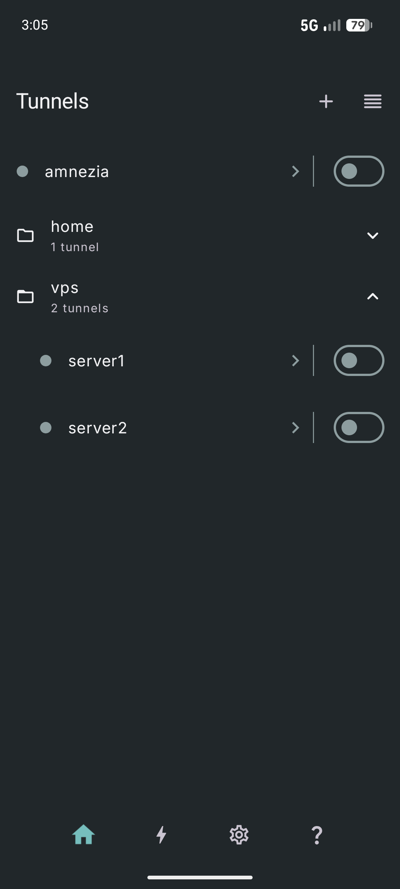
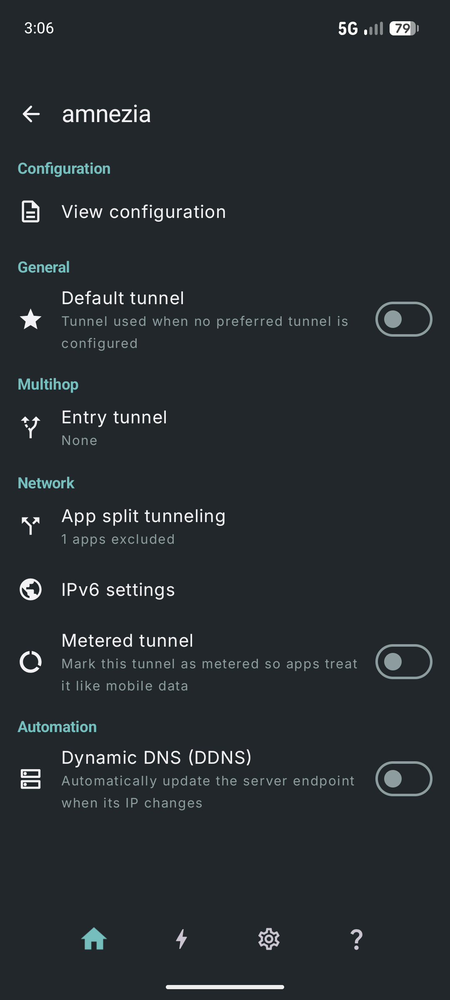
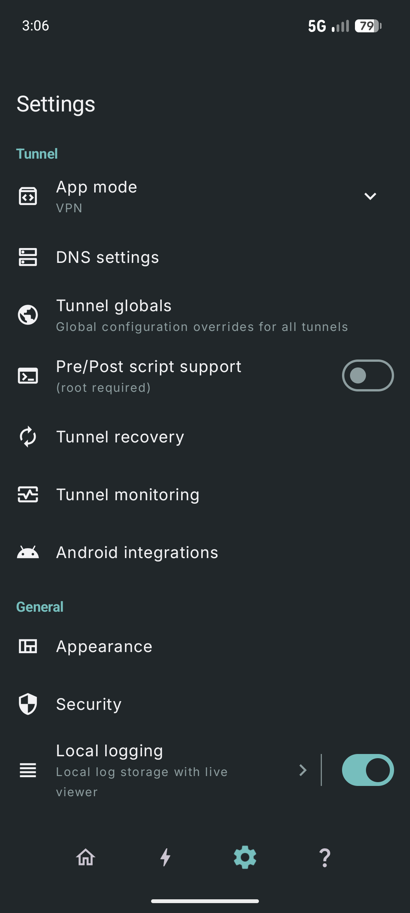
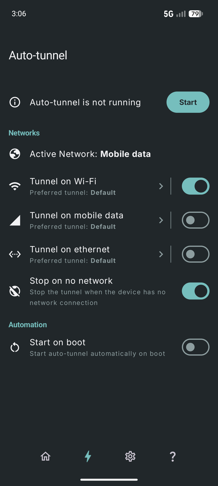

<h1 align="center">
WG Tunnel
</h1>

<div align="center">

An alternative FOSS Android client for [WireGuard](https://www.wireguard.com/)
and [AmneziaWG](https://docs.amnezia.org/documentation/amnezia-wg/)
<br />
<br />
<a href="https://github.com/zaneschepke/wgtunnel/issues/new?assignees=zaneschepke&labels=bug&projects=&template=bug_report.md&title=%5BBUG%5D+-+Problem+with+app">Report a Bug</a>
·
<a href="https://github.com/zaneschepke/wgtunnel/issues/new?assignees=zaneschepke&labels=enhancement&projects=&template=feature_request.md&title=%5BFEATURE%5D+-+New+feature+request">Request a Feature</a>
·
<a href="https://github.com/zaneschepke/wgtunnel/discussions">Ask a Question</a>

</div>

<br/>

<div align="center">

[](https://play.google.com/store/apps/details?id=com.zaneschepke.wireguardautotunnel)
[](https://apt.izzysoft.de/fdroid/index/apk/com.zaneschepke.wireguardautotunnel)
[](https://fdroid.wgtunnel.com)
[](https://apps.obtainium.imranr.dev/redirect?r=obtainium://app/%7B%22id%22%3A%22com.zaneschepke.wireguardautotunnel%22%2C%22url%22%3A%22https%3A%2F%2Fgithub.com%2Fzaneschepke%2Fwgtunnel%22%2C%22author%22%3A%22zaneschepke%22%2C%22name%22%3A%22WG%20Tunnel%22%2C%22preferredApkIndex%22%3A0%2C%22additionalSettings%22%3A%22%7B%5C%22includePrereleases%5C%22%3Afalse%2C%5C%22fallbackToOlderReleases%5C%22%3Atrue%2C%5C%22filterReleaseTitlesByRegEx%5C%22%3A%5C%22%5C%22%2C%5C%22filterReleaseNotesByRegEx%5C%22%3A%5C%22%5C%22%2C%5C%22verifyLatestTag%5C%22%3Atrue%2C%5C%22sortMethodChoice%5C%22%3A%5C%22date%5C%22%2C%5C%22useLatestAssetDateAsReleaseDate%5C%22%3Afalse%2C%5C%22releaseTitleAsVersion%5C%22%3Afalse%2C%5C%22trackOnly%5C%22%3Afalse%2C%5C%22versionExtractionRegEx%5C%22%3A%5C%22%5C%22%2C%5C%22matchGroupToUse%5C%22%3A%5C%22%5C%22%2C%5C%22versionDetection%5C%22%3Atrue%2C%5C%22releaseDateAsVersion%5C%22%3Afalse%2C%5C%22useVersionCodeAsOSVersion%5C%22%3Afalse%2C%5C%22apkFilterRegEx%5C%22%3A%5C%22%5C%22%2C%5C%22invertAPKFilter%5C%22%3Afalse%2C%5C%22autoApkFilterByArch%5C%22%3Atrue%2C%5C%22appName%5C%22%3A%5C%22WG%20Tunnel%5C%22%2C%5C%22appAuthor%5C%22%3A%5C%22Zane%20Schepke%5C%22%2C%5C%22shizukuPretendToBeGooglePlay%5C%22%3Afalse%2C%5C%22allowInsecure%5C%22%3Afalse%2C%5C%22exemptFromBackgroundUpdates%5C%22%3Afalse%2C%5C%22skipUpdateNotifications%5C%22%3Afalse%2C%5C%22about%5C%22%3A%5C%22%5C%22%2C%5C%22refreshBeforeDownload%5C%22%3Afalse%7D%22%2C%22overrideSource%22%3Anull%7D)

</div>

<div align="center">

[](https://t.me/wgtunnel)
[](https://matrix.to/#/#wg-tunnel-space:matrix.org)
</div>

<details open="open">
<summary>Table of Contents</summary>

- [About](#about)
- [Screenshots](#screenshots)
- [Features](#features)
- [Building](#building)
- [Translation](#translation)
- [Acknowledgements](#acknowledgements)
- [Contributing](#contributing)

</details>

<div style="text-align: left;">

## About

WG Tunnel is an alternative Android client for WireGuard and AmneziaWG, inspired by the official WireGuard Android app. It fills gaps in the official client by adding advanced features like auto-tunneling, AmneziaWG support, different app modes like **Lockdown** (a custom kill switch for leak prevention), and **Local Proxy** (expose a tunnel over a local SOCKS5/HTTP proxy server) for enhanced privacy, censorship resistance, and flexibility.
 
</div>

<div style="text-align: left;">

## Screenshots

</div>
<div style="display: flex; flex-wrap: wrap; justify-content: left; gap: 10px;">
    
    
    
    
</div>

## Features

- **Auto-Tunneling:** Automatically activate tunnels based on your device's active network details.
- **Deferred Endpoint Bootstrapping:** Safely resolves endpoints and updates peers after the tunnel is up for better reliability and leak protection on startup.
- **Handshake Monitoring:** Real-time handshake monitoring for instant tunnel health feedback.
- **AmneziaWG Support:** Full support for AmneziaWG 2.0 through 3.1, providing robust censorship protection.
- **Split Tunneling:** Flexible support for routing specific apps or traffic through the VPN.
- **Split & Encrypted DNS:** Resolve DNS through the tunnel using plain DNS, DoT, or DoH, and optionally split by domain suffix (tunnel or system).
- **Local Proxy Mode:** Expose WireGuard tunnels over a local SOCKS5 or HTTP proxy to browsers or firewall apps (like AdGuard).
- **Lockdown Mode:** Advanced in-app kill switch that blocks all traffic while the tunnel is down.
- **Quick Controls:** Quick Settings tile and home screen shortcuts for easy toggling.
- **Remote Control Support:** Intent-based automation for controlling tunnels and auto-tunneling from automation apps (like Tasker).
- **Dynamic DNS Handling:** Automatically detect and update endpoints on server IP changes without requiring a restart.
- **IPv6 Endpoints:** Automatically upgrade to IPv6 endpoints or fall back to IPv4 based on network conditions without requiring a restart.
- **Android TV Support:** Full support for nearly all features on Android TV.

## Building

The app consumes published [core](https://github.com/wgtunnel/core) artifacts from Maven Central by default (`libs.bundles.wgtunnel.core`). That is enough for most app-only work.

```sh
git clone https://github.com/wgtunnel/android
cd android
./gradlew assembleDebug
```

### Local full build (app + core)

To build against a local core checkout (native JNI, backend, parser, hevtunnel), clone **core next to this repo**:

```
parent/
  android/    # this repository
  core/       # https://github.com/wgtunnel/core
```

```sh
cd /path/to/parent
git clone https://github.com/wgtunnel/android
git clone https://github.com/wgtunnel/core
cd android
```

You also need the [core build requirements](https://github.com/wgtunnel/core#requirements) (JDK 21, Android NDK, `make`, a C toolchain).

Then switch Gradle from Maven Central to the composite build:

1. In `settings.gradle.kts`, uncomment the local-dev `includeBuild`:

```kotlin
// Local dev
includeBuild("../core") {
	dependencySubstitution {
		substitute(module("com.wgtunnel.tunnel:backend"))
			.using(project(":backend"))
		substitute(module("com.wgtunnel.tunnel:backend-android-jni"))
			.using(project(":backend-android-jni"))
	}
}
```

2. In `app/build.gradle.kts`, comment out the Maven bundle and uncomment the local-dev implementations:

```kotlin
dependencies {
    implementation(project(":logcatter"))
    implementation(project(":networkmonitor"))
    // implementation(libs.bundles.wgtunnel.core)

    // Local dev
    implementation("com.wgtunnel.tunnel:backend")
    implementation("com.wgtunnel.tunnel:backend-android-jni")
}
```

3. Build from `android/`:

```sh
./gradlew assembleDebug
```

Do not commit those Gradle edits. Restore the commented `includeBuild` and Maven `libs.bundles.wgtunnel.core` dependency before opening a PR.

## Translation

Help translate WG Tunnel on [Crowdin](https://translate.wgtunnel.com/project/wgtunnel/invite?h=11b5b7bf2099293095775d4477320c772818907).

<!-- CROWDIN-CONTRIBUTORS-START -->
<table>
  <tbody>
    <tr>
      <td align="center" valign="top">
        <a href="https://crowdin.com/profile/zaneschepke">
          <br />
          <sub><b>Zane Schepke</b></sub>
          <br />
          <sub><b>(zaneschepke)</b></sub></a>
        <br />
        <sub><b>249913 words</b></sub>
      </td>
      <td align="center" valign="top">
        <a href="https://crowdin.com/profile/martinellimarco">
          <br />
          <sub><b>Marco Martinelli</b></sub>
          <br />
          <sub><b>(martinellimarco)</b></sub></a>
        <br />
        <sub><b>4661 words</b></sub>
      </td>
      <td align="center" valign="top">
        <a href="https://crowdin.com/profile/Pida88">
          <br />
          <sub><b>Petr Sedl</b></sub>
          <br />
          <sub><b>(Pida88)</b></sub></a>
        <br />
        <sub><b>2211 words</b></sub>
      </td>
      <td align="center" valign="top">
        <a href="https://crowdin.com/profile/Surfoo">
          <br />
          <sub><b>Surfoo</b></sub></a>
        <br />
        <sub><b>1984 words</b></sub>
      </td>
      <td align="center" valign="top">
        <a href="https://crowdin.com/profile/Matthaiks">
          <br />
          <sub><b>Matthaiks</b></sub></a>
        <br />
        <sub><b>1849 words</b></sub>
      </td>
      <td align="center" valign="top">
        <a href="https://crowdin.com/profile/solokot">
          <br />
          <sub><b>solokot</b></sub></a>
        <br />
        <sub><b>1107 words</b></sub>
      </td>
      <td align="center" valign="top">
        <a href="https://crowdin.com/profile/alis36">
          <br />
          <sub><b>Ali Saeedi</b></sub>
          <br />
          <sub><b>(alis36)</b></sub></a>
        <br />
        <sub><b>1050 words</b></sub>
      </td>
    </tr>
    <tr>
      <td align="center" valign="top">
        <a href="https://crowdin.com/profile/justcontributor">
          <br />
          <sub><b>그냥기여자</b></sub>
          <br />
          <sub><b>(justcontributor)</b></sub></a>
        <br />
        <sub><b>965 words</b></sub>
      </td>
      <td align="center" valign="top">
        <a href="https://crowdin.com/profile/LEDPixel">
          <br />
          <sub><b>LEDPixel</b></sub></a>
        <br />
        <sub><b>950 words</b></sub>
      </td>
      <td align="center" valign="top">
        <a href="https://crowdin.com/profile/cyanwolfg">
          <br />
          <sub><b>CyanWolf</b></sub>
          <br />
          <sub><b>(cyanwolfg)</b></sub></a>
        <br />
        <sub><b>891 words</b></sub>
      </td>
      <td align="center" valign="top">
        <a href="https://crowdin.com/profile/EvanTechDev">
          <br />
          <sub><b>Evan Huang</b></sub>
          <br />
          <sub><b>(EvanTechDev)</b></sub></a>
        <br />
        <sub><b>751 words</b></sub>
      </td>
      <td align="center" valign="top">
        <a href="https://crowdin.com/profile/pixnet">
          <br />
          <sub><b>pixnet</b></sub></a>
        <br />
        <sub><b>378 words</b></sub>
      </td>
      <td align="center" valign="top">
        <a href="https://crowdin.com/profile/zlronron159">
          <br />
          <sub><b>ron</b></sub>
          <br />
          <sub><b>(zlronron159)</b></sub></a>
        <br />
        <sub><b>320 words</b></sub>
      </td>
      <td align="center" valign="top">
        <a href="https://crowdin.com/profile/ppac">
          <br />
          <sub><b>Philip</b></sub>
          <br />
          <sub><b>(ppac)</b></sub></a>
        <br />
        <sub><b>273 words</b></sub>
      </td>
    </tr>
    <tr>
      <td align="center" valign="top">
        <a href="https://crowdin.com/profile/YuryKomar">
          <br />
          <sub><b>YuryKomar</b></sub></a>
        <br />
        <sub><b>271 words</b></sub>
      </td>
      <td align="center" valign="top">
        <a href="https://crowdin.com/profile/georgybog">
          <br />
          <sub><b>georgybog</b></sub></a>
        <br />
        <sub><b>257 words</b></sub>
      </td>
      <td align="center" valign="top">
        <a href="https://crowdin.com/profile/darbrzozo">
          <br />
          <sub><b>Dariusz</b></sub>
          <br />
          <sub><b>(darbrzozo)</b></sub></a>
        <br />
        <sub><b>125 words</b></sub>
      </td>
    </tr>
  </tbody>
</table>
<!-- CROWDIN-CONTRIBUTORS-END -->

## Acknowledgements

Thank you to the following:

- All of the users that have helped contribute to the project with ideas, translations, feedback, bug reports, testing, and donations.
- [WireGuard](https://www.wireguard.com/) - Jason A. Donenfeld (https://github.com/WireGuard/wireguard-android)
- [AmneziaWG](https://docs.amnezia.org/documentation/amnezia-wg/) - Amnezia Team (https://github.com/amnezia-vpn/amneziawg-android)
- [JetBrains](https://jetbrains.com) - For supporting open-source developers with free software licenses.

## Contributing

Any contributions in the form of feedback, issues, code, or translations are welcome and much
appreciated!

For PRs, please make sure to format before submitting.

```sh
./gradlew format
```

CI runs `./gradlew formatCheck`, which uses the same files and style as `format`. If that job fails, run `./gradlew format` and commit the result.

If your PR requires [core](https://github.com/wgtunnel/core) changes, please link the associated PR. 
